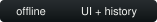
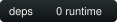
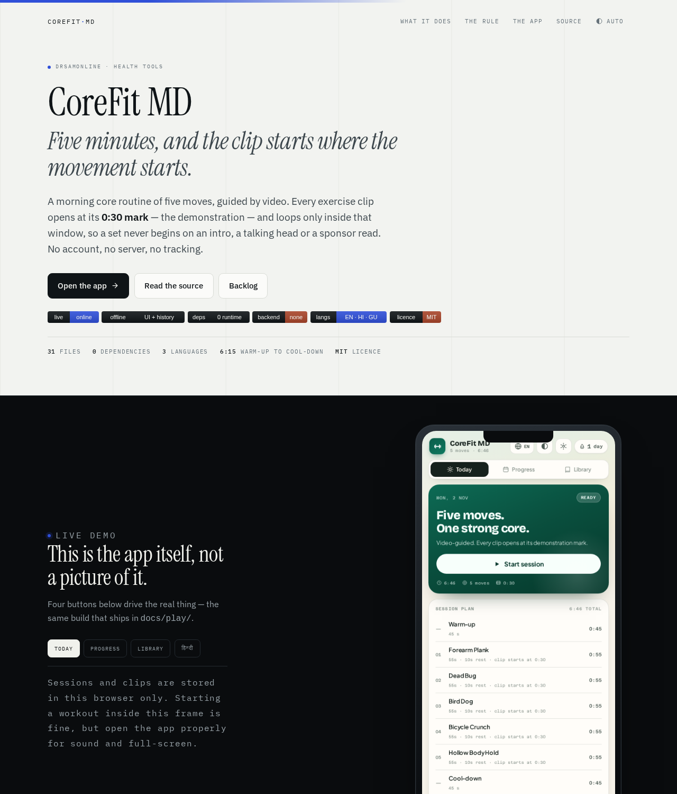

# CoreFit MD

[](LICENSE)

<p>
  <a href="https://drsamonline.github.io/corefit-md/"></a>
  
  
  
  
  <a href="LICENSE"></a>
</p>

**A five-minute morning core routine where every set opens on the demonstration, not the intro.**

**[Open the app →](https://drsamonline.github.io/corefit-md/play/)** · [Landing page](https://drsamonline.github.io/corefit-md/) · [The rule](#the-rule) · [Backlog](BACKLOG.md)

<!-- shot:start -->



<!-- shot:end -->

No account, no server, no build step, no dependencies. `docs/play/` is the entire
application — eight small scripts on one namespace, one stylesheet, three self-hosted
fonts. It runs from `file://` by opening `index.html`, and installs as a PWA when served
over HTTPS.

## The rule

Most workout apps embed a video and press play, so the set begins with a channel ident and
a presenter explaining the move. Here the clip window is data:

```js
{ videoId: 'ASdvN_XEl_c', clip: { start: 30, end: 55 } }
```

The player is created with `start=30`, seeked again the moment it reports ready, and
re-seeked whenever playback passes the window end — so fifty seconds of plank keeps showing
the plank. During each rest interval the next exercise is preloaded with `cueVideoById`,
which removes the black frame at the top of the following set. Every window is editable in
the app's Library: scrub, hit **now** on either field, save.

## Where the motion comes from

`Settings → Clip source` decides:

- **YouTube** (default) — the 0:30 clip window plays when the embed loads. Four of the five
  original IDs are alive; Bird Dog was replaced after the original 404'd.
- **Local** — no network request of any kind. Motion comes from `assets/media/` if a clip
  exists there; otherwise the still is shown.

Either way, every move has a **local still** in `assets/media/` (watermarked, 1280×720), so a
blocked embed, a dead video or a flight turns the workout into a slideshow rather than a black
box. Animated SVG figures remain underneath that as the final fallback.

On the first visit over HTTPS the service worker caches every media file in the manifest, so
one session online makes the stills available offline afterwards.

## When there is no network

Every move ships an **animated SVG figure** drawn for this app (`docs/play/assets/demo/`,
1.5–2.2 KB each). It replaces the player automatically when:

- the clip is dead — one of the original five IDs had been deleted, which is what started this;
- the embed is blocked or errors;
- the device is offline (`navigator.onLine === false`);
- the clip is shorter than its window (the player clamps the window to the real duration);
- you flip the **Clips / Figures only** switch at the top of the Library (also in Settings → Video).

Tapping any library card opens the sheet even with no video at all: it shows the animated figure,
a link to open the clip on YouTube, and a search for a better one.

The figures are original drawings, not frames from the videos: the clips are other people's
work, so they are embedded and credited — the channel name sits under the player and every
source is listed in the app's *Sources and credits* sheet. Nothing is copied into the repo.

## Generated assets

`PROMPTS.md` is the brief for replacing the figures with AI-generated stills and video loops:
a shared style block, a character-lock strategy, ten per-move prompts (image and motion),
negative prompts, an acceptance checklist, and the watermark spec.

All ten moves now have a generated still in `docs/play/assets/media/` — watermarked,
1280×720, 68–127 KB each. The animated SVG figures remain as the fallback for anything
missing, and as the source for the `scripts/figures.py` pipeline.

Drop more into `docs/play/assets/media/` and run `python3 scripts/media_manifest.py`.
The app prefers them over the figures everywhere, per exercise, falling back for anything
missing — so a partial set is fine. `scripts/watermark.py` stamps the CoreFit MD mark onto
stills (Pillow) and clips (ffmpeg).

## What it does

| | |
|---|---|
| Moves per session | **5**, plus warm-up and cool-down |
| Session length | **6:15** at week 1, **7:10** at peak |
| Progression | **6 weeks**, 45 → 60 s work, deload at week 4, driven by sessions logged |
| Languages | **English · हिन्दी · ગુજરાતી**, locale-aware dates |
| Storage | `localStorage` — history, clips, settings, profile |
| Offline figures | **10** animated SVGs, 19 KB total |
| Runtime dependencies | **0** |
| App size | **363 KB**, 31 files |

Sessions carry pause, skip, restart, ±10 s, per-side splitting for unilateral moves, an
optional rep-counting mode, and resume-after-interruption. Logging carries streaks with a
one-day grace, a weekly goal, 30-day consistency, post-session RPE, a pain flag and a note.
Export is CSV, JSON backup/restore, or a printable summary.

## What it must not do, and does not

- **No account, no sign-in, no sync.** There is no server to sync with. A backup file is the whole sync story.
- **No analytics, no third-party scripts.** The only network requests are the video embed and its thumbnail.
- **No streak mechanics that punish rest.** One missed day is forgiven anywhere in the chain; two in a row end it.
- **No medical claims.** It screens for contraindications, offers an easier variation, and tells you to stop if a move hurts. It is a training aid.

## Run it

```bash
git clone https://github.com/drsamonline/corefit-md
cd corefit-md
python3 -m http.server 8080      # then open localhost:8080/docs/

# or just the app, straight from disk:
open docs/play/index.html

# regenerate the committed assets
python3 scripts/badges.py
bash scripts/shot.sh . app
```

## Layout

```
docs/index.html            the landing page (its own design; serif, cobalt, dark demo band)
docs/play/index.html       the app — markup only
docs/play/assets/css/      one stylesheet, light + dark + big-text + landscape
docs/play/assets/js/       config · data · store · i18n · video · session · ui · main
docs/play/assets/i18n/     en / hi / gu string tables
docs/play/assets/demo/     10 animated SVG demonstrations (offline fallback)
docs/play/sw.js            offline shell: HTML network-first, assets stale-while-revalidate
docs/assets/               screenshots + badges generated by scripts/badges.py
scripts/                   badges.py, figures.py, shot.sh
BACKLOG.md                 everything next that needs no server — and what is refused
```

## Support


Free, offline, accountless — and staying that way. If it earned its keep:

| | |
|---|---|
| UPI (India) | `drsohilboi@ybl` — payee Dr. Sohil Momin, open amount, or scan [the QR](docs/assets/upi-qr.svg) |
| Ko-fi | [ko-fi.com/matneo](https://ko-fi.com/matneo) |
| PayPal | [paypal.me/drsohilmomin](https://paypal.me/drsohilmomin?locale.x=en_GB&country.x=IN) |
| My books | [Amazon author store](https://www.amazon.com/stores/author/B08ZT331LY/allbooks?ccs_id=aed72b9f-71d9-41dc-adee-e9368a317acc) |
| More apps | [drsamonline.github.io](https://drsamonline.github.io/) |
| Email | [sohilmomin2000@gmail.com](mailto:sohilmomin2000@gmail.com) |

Nothing is gated behind it: no accounts, no tracking, no network requests.

## Licence

MIT — see `LICENSE`. Video embeds belong to their creators.

---

## Author

**Dr Sohil Momin** — [@drsamonline](https://github.com/drsamonline)

Built as a personal morning routine and published so it can be forked. The clinical
screening, contraindication flags and regression notes are written from a doctor's
viewpoint, not scraped from a fitness blog; the training content is ordinary core work
anyone can do on a mat.

Not medical advice. If a movement hurts, stop and see someone qualified.
